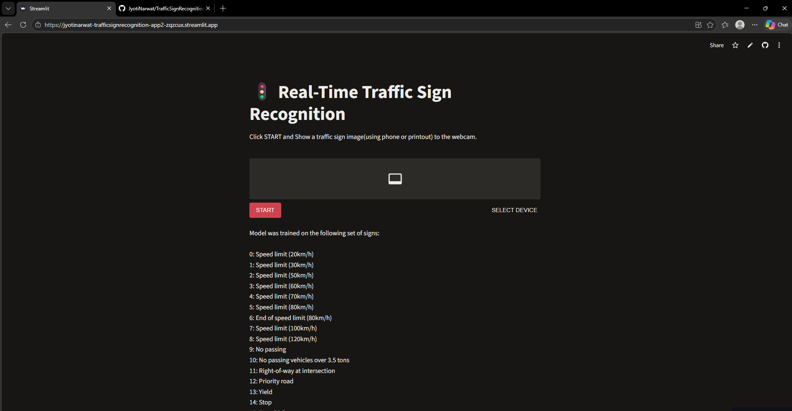
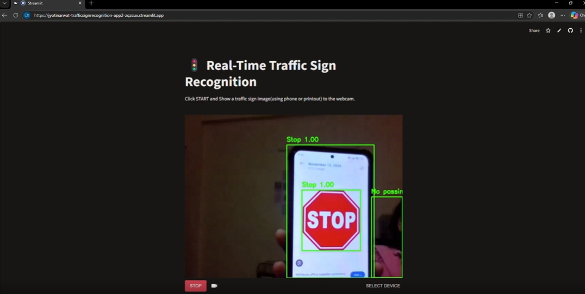

# Real-Time Traffic Sign Recognition System

A deep learning-based Traffic Sign Recognition System that detects and classifies traffic signs in real time using a webcam feed. The project combines Computer Vision, Convolutional Neural Networks (CNNs), OpenCV, YOLO-based detection, and Streamlit deployment to provide an interactive traffic sign recognition application.

---

## Overview

Traffic signs play a critical role in road safety and autonomous driving systems. This project aims to automatically recognize and classify traffic signs from images and live video streams.

The model was trained on the German Traffic Sign Recognition Benchmark (GTSRB) dataset consisting of 43 traffic sign categories. A custom CNN model was built and trained to achieve high classification accuracy. The trained model was then integrated into a real-time application capable of recognizing traffic signs through a webcam interface.

---

## Features

- Real-time traffic sign recognition
- Webcam-based prediction
- Deep Learning CNN classifier
- YOLO-assisted traffic sign detection
- Supports 43 traffic sign classes
- High accuracy classification
- Streamlit web interface
- Confidence score display
- Bounding box visualization for detected signs

---

## Project Screenshots

### Home Screen



---

### Real-Time Detection

> Insert Screenshot Here




---

## Demo Video Link Here

```text
https://github.com/JyotiNarwat/TrafficSignRecognition/assets/demo-video.mp4
```

---

##  System Architecture

```text
Webcam Feed
      │
      ▼
 YOLO Detection
      │
      ▼
 Traffic Sign Crop
      │
      ▼
 CNN Classifier
      │
      ▼
 Predicted Traffic Sign
      │
      ▼
 Streamlit Interface
```

---

## 📂Dataset

### German Traffic Sign Recognition Benchmark (GTSRB)

The model was trained using the GTSRB dataset which contains:

- 43 Traffic Sign Classes
- 50,000+ Images
- Real-world traffic sign samples
- Varying lighting conditions and viewpoints

Example Classes:

- Speed Limit 20 km/h
- Speed Limit 30 km/h
- Speed Limit 50 km/h
- Stop
- No Entry
- Yield
- Pedestrian Crossing
- Roundabout Mandatory

---

## 🧠 CNN Architecture
I designed a Convolutional Neural Network (CNN) for traffic sign classification using the GTSRB dataset. The model accepts 30×30 RGB images as input and begins with two convolutional layers containing 16 and 32 filters, which learn low-level visual features such as edges, curves, and boundaries of traffic signs. These are followed by a max-pooling layer to reduce spatial dimensions and a batch normalization layer to improve training stability and convergence. A second convolutional block with 64 and 128 filters is then used to extract more complex patterns, including sign shapes, symbols, and numerical markings. Another max-pooling and batch normalization stage further reduces computational complexity while maintaining important features.

After feature extraction, the resulting feature maps are flattened and passed to a fully connected dense layer with 512 neurons, which learns high-level representations required for classification. A dropout layer with a rate of 0.5 is applied to prevent overfitting by randomly disabling neurons during training. Finally, the output layer consists of 43 neurons with a Softmax activation function, corresponding to the 43 traffic sign classes in the dataset. I chose this architecture because it progressively learns from simple visual features to complex traffic sign patterns while maintaining a balance between model performance and computational efficiency. Combined with data augmentation, normalization, and the Adam optimizer, the model achieved approximately 99.7% validation accuracy on the GTSRB dataset.

### Convolutional Layers

A convolutional layer is the core building block of a CNN and is responsible for automatically extracting important features from an image. Instead of looking at the entire image at once, it uses small filters (or kernels), such as 3×3 matrices, which slide across the image and detect patterns. In the early layers, these filters learn simple features like edges, corners, curves, and color transitions. As the network goes deeper, the convolutional layers combine these simple features to recognize more complex patterns such as circles, triangles, numbers, symbols, and eventually complete traffic signs. In my project, I used convolutional layers with 16, 32, 64, and 128 filters. The increasing number of filters allows the network to learn a greater variety of features at each level. This hierarchical feature learning enables the model to distinguish between visually similar traffic signs and achieve high classification accuracy.